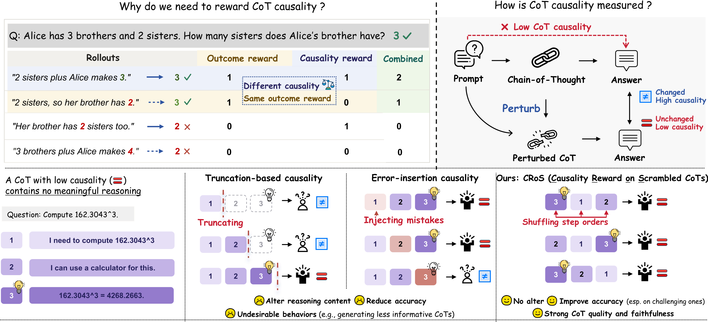

<div align="center">

<h1>CRoS: Causality Reward on Scrambled CoTs Improves Accuracy and Reasoning Faithfulness</h1>

<p>
<a href="https://xiaoyu-1217.github.io/">Xiao Yu</a>&emsp;
<a href="https://dinobby.github.io/">Justin Chih-Yao Chen</a>&emsp;
<a href="https://zaidkhan.me/">Zaid Khan</a>&emsp;
<a href="https://amy-hyunji.github.io/">Hyunji Lee</a>&emsp;
<a href="https://www.cs.unc.edu/~mbansal/">Mohit Bansal</a>
</p>

<p>UNC Chapel Hill</p>

<p>
<a href="https://arxiv.org/abs/2610.42054"></a>&ensp;
<a href="https://xxiaoyuuuu.github.io/CRoS-Page/"></a>&ensp;
<a href="https://github.com/xxiaoyuuuu/CRoS"></a>&ensp;
<a href="https://huggingface.co/xxiaoyuuuu/Gemma-3-4B-IT-CRoS"></a>&ensp;
<a href="#citation"></a>
</p>

</div>

**TL;DR:** CRoS (Causality Reward on Scrambled CoTs) introduces a causality reward that captures the causal relationship between the CoT and the final answer. By combining this reward with the outcome reward, we demonstrate improvements in both accuracy and reasoning faithfulness.

## Reproducibility and Open-Source Resources

To support reproducibility and transparent evaluation, we publicly release the code, model checkpoints, and evaluation responses associated with this work.

- **Code**: Training scripts, implementations of CRoS and five baseline reward functions.
- **Models**: Trained LoRA adapters for CRoS and all five baselines (Outcome, Early Answering, Adding Mistakes, CIR, and SR). See [Released checkpoints](#released-checkpoints).
- **Evaluation data**: Per-question model responses and evaluation results are available in [`Gemma-3-4B-IT-CRoS-eval`](https://huggingface.co/datasets/xxiaoyuuuu/Gemma-3-4B-IT-CRoS-eval). These include sampled responses for each table, including accuracy evaluations across difficulty levels (500 question of Table 1), Pass@K and CoT-Pass@K (Table 2), and faithfulness (Table 3).

## Overview

Outcome rewards cannot distinguish between CoTs that produce the same correct answer, motivating the need to incorporate CoT causality into optimization.

A real example of a low-causality CoT that contains no meaningful reasoning. Existing metrics assign high causality scores due to information sensitivity: truncation-based metrics remove answer-related information in the final step, while error-insertion metrics introduce errors that affect the final answer. In contrast, CRoS (Causality Reward on Scrambled CoTs) preserves the original content while reordering reasoning steps, leaving the final answer unchanged and correctly indicating low causality.

<p align="center">
  
</p>

## Installation

Linux, NVIDIA GPUs with CUDA 12.6+, conda.

```bash
conda create -n cros python=3.10 -y
conda activate cros
pip install -r requirements.txt
pip install --no-deps -e ./verl   # keep the versions in requirements.txt
```

## Training

CRoS require a frozen base model for CoT scoring:

```bash
CUDA_VISIBLE_DEVICES=0 vllm serve $PWD/models/gemma-3-4b-it --port 8740 --max-model-len 16384 \
    --gpu-memory-utilization 0.6 --enforce-eager --limit-mm-per-prompt '{"image": 0}'
```

Then train on two other GPUs:

```bash
REWARD=cros DATASET=aiw_survo DEVICES=0,1 bash train.sh
```

| Variable | Values |
|---|---|
| `REWARD` | `cros` (default, ours); baselines `outcome`, `early_answering`, `adding_mistakes`, `cir`, `sr` |
| `DATASET` | `aiw_survo` (default, 300 steps), `survo` (200 steps), `games5` (300 steps, 8,192-token responses; Appendix D) |
| `LAMBDA` | CRoS reward weight λ (default 0.3; Appendix H studies 1.0) |
| `DEVICES`, `MODEL`, `FROZEN_URL` | training GPUs, base model path, URL of the frozen-model server |

**Hardware.** Each training run uses two GPUs for the policy and one for the frozen model server. Training was conducted on NVIDIA A100 (80GB), H100 (80GB), and RTX PRO 6000 Blackwell (96GB) GPUs, taking approximately 15–20 hours per run.

## Evaluation

Merge the LoRA into the base model in fp32, from a training checkpoint or a released
adapter. **Do not merge or evaluate in bf16**: rounding to bf16 erases most of the LoRA update.

```bash
python evaluation/merge.py --ckpt checkpoints/cros_gemma3_aiw_survo/global_step_300 \
    --base models/gemma-3-4b-it --out merged/cros
python evaluation/merge.py --adapter <adapter dir> --base models/gemma-3-4b-it --out merged/cros
```

**Accuracy**

Answer accuracy on the training tasks (AIW, Survo) and five unseen datasets (Zebra Puzzles, Circuit Logic, Puzzle24,
Knights and Knaves, Countdown), at the default and four difficulty levels.

```bash
# generate
for k in 1 2 3 4; do
    python evaluation/generate.py --model merged/cros --data evaluation/data/accuracy/L$k --out results/cros/accuracy/L$k
done
# evaluate
python evaluation/accuracy.py results/cros results/base
```

**CoT quality**

Pass@K and CoT-Pass@K on the five unseen datasets, 256 samples per question. For CoT-Pass@K, a correct answer only
counts if DeepSeek-R1-0528-Qwen3-8B also judges its CoT correct.

```bash
# generate
python evaluation/generate.py --model merged/cros --data evaluation/data/passk --out results/cros/passk \
    --n 256 --temperature 1.0 --top_p 1.0 --max_tokens 4096 --max_model_len 8192
# evaluate
python evaluation/CoT_quality_pass.py judge results/cros/passk --judge models/DeepSeek-R1-0528-Qwen3-8B
python evaluation/CoT_quality_pass.py report results/cros/passk
```

**CoT faithfulness**

On 27 Reasoning Gym datasets, four types of hints (Grader, User, Metadata, Unethical) point to a wrong answer. When the
model follows a hint, Gemini 2.5 Flash judges whether its CoT acknowledges using it.

```bash
# generate
python evaluation/CoT_faithfulness_hint.py run --model merged/cros --out results/cros/hint
# evaluate
GEMINI_API_KEY=<your key> python evaluation/CoT_faithfulness_hint.py judge results/cros/hint
python evaluation/CoT_faithfulness_hint.py report results/base/hint results/cros/hint
```

## Released checkpoints

All six models are released as PEFT LoRA adapters (r = 32) for `google/gemma-3-4b-it`, trained for 300 GRPO steps on AIW and Survo:

| Method | `REWARD` | Hugging Face |
|---|---|---|
| **CRoS** (ours) | `cros` | [xxiaoyuuuu/Gemma-3-4B-IT-CRoS](https://huggingface.co/xxiaoyuuuu/Gemma-3-4B-IT-CRoS) |
| Outcome reward | `outcome` | [xxiaoyuuuu/Gemma-3-4B-IT-Outcome](https://huggingface.co/xxiaoyuuuu/Gemma-3-4B-IT-Outcome) |
| Early Answering | `early_answering` | [xxiaoyuuuu/Gemma-3-4B-IT-EarlyAnswering](https://huggingface.co/xxiaoyuuuu/Gemma-3-4B-IT-EarlyAnswering) |
| Adding Mistakes | `adding_mistakes` | [xxiaoyuuuu/Gemma-3-4B-IT-AddingMistakes](https://huggingface.co/xxiaoyuuuu/Gemma-3-4B-IT-AddingMistakes) |
| CIR | `cir` | [xxiaoyuuuu/Gemma-3-4B-IT-CIR](https://huggingface.co/xxiaoyuuuu/Gemma-3-4B-IT-CIR) |
| SR | `sr` | [xxiaoyuuuu/Gemma-3-4B-IT-SR](https://huggingface.co/xxiaoyuuuu/Gemma-3-4B-IT-SR) |

## Citation

```bibtex
@misc{yu2026croscausalityrewardscrambled,
      title={CRoS: Causality Reward on Scrambled CoTs Improves Accuracy and Reasoning Faithfulness},
      author={Xiao Yu and Justin Chih-Yao Chen and Zaid Khan and Hyunji Lee and Mohit Bansal},
      year={2026},
      eprint={2610.42054},
      archivePrefix={arXiv},
      primaryClass={cs.CL},
      url={https://arxiv.org/abs/2610.42054},
}
```

## License and acknowledgements

The code in this repository is released under the Apache License 2.0 (see `LICENSE` and `NOTICE`). `verl/` is a
modified copy of [verl](https://github.com/volcengine/verl) (Apache-2.0, Bytedance). Training and evaluation
questions come from [Reasoning Gym](https://github.com/open-thought/reasoning-gym) (Apache-2.0). Released model
weights are derivatives of Gemma-3-4B-IT and are subject to the Gemma Terms of Use. The refusal evaluation uses
[AbstentionBench](https://github.com/facebookresearch/AbstentionBench), The Impossible Test and SelfAware under
their own licenses.
